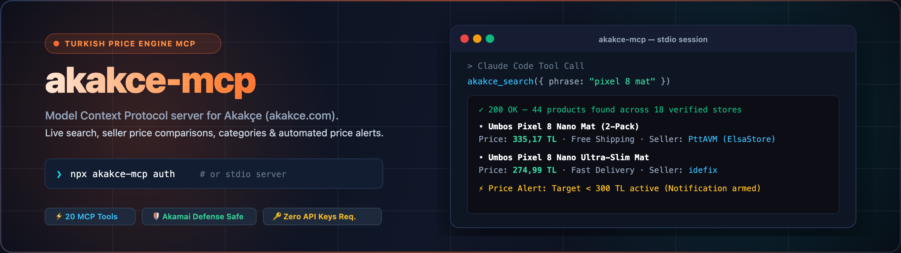

<p align="center">
  
</p>

<p align="center">
  <a href="https://github.com/nsozturk/akakce-mcp"></a>
  
  <a href="LICENSE"></a>
  
  
  <a href="AGENTS.md"></a>
  
</p>

<p align="center">
  <code>mcp</code> &bull; <code>model-context-protocol</code> &bull; <code>akakce</code> &bull; <code>price-comparison</code> &bull; <code>ecommerce</code> &bull; <code>claude-code</code> &bull; <code>cursor-agent</code> &bull; <code>turkey</code> &bull; <code>scraper</code> &bull; <code>typescript</code>
</p>

---

**akakce-mcp** is a free, open-source Model Context Protocol (MCP) server for [Akakçe](https://www.akakce.com) that equips AI agents with real-time Turkish price comparison, multi-seller market intelligence, and automated price drop alerts.

📖 **Documentation Portal:** [https://nsozturk.github.io/akakce-mcp/](https://nsozturk.github.io/akakce-mcp/) &bull; **AI/LLM Index:** [`llms.txt`](https://nsozturk.github.io/akakce-mcp/llms.txt) &bull; [`llms-full.txt`](https://nsozturk.github.io/akakce-mcp/llms-full.txt)

---

## Key Highlights

- **🛡️ Akamai Bot Protection Bypassed:** Standard Node `fetch` / Axios clients are fingerprinted and blocked with `HTTP 403 Forbidden`. `akakce-mcp` routes requests through system `curl` using verified browser and mobile App headers (`Akakce/100 CFNetwork/...`), ensuring reliable zero-ban connectivity.
- **⚡ 20 Structured MCP Tools:** Everything from query autocomplete and paginated filtered search to full seller price lists with shipping fees, seller ratings, and direct outbound links.
- **🔑 Zero Key Floor for Public Features:** Search, seller comparison, deals, and category browsing work out-of-the-box with zero credentials required.
- **🔒 Secure Token Management:** Account features (wishlists, price alerts) use isolated local session storage (`~/.config/akakce-mcp/session.json` with `0600` permissions) or environment variables. Zero credentials are ever saved in the repository.

---

## Quickstart

Run directly without installing:

```bash
# Start MCP server (stdio transport)
npx -y akakce-mcp
```

Or install globally:

```bash
npm install -g akakce-mcp
```

> **Requirement:** System `curl` must be available in your PATH (standard on macOS, Linux, and modern Windows 10/11).

---

## Client Integration

### 1. Claude Code
```bash
claude mcp add akakce -- npx -y akakce-mcp
```

### 2. Cursor IDE
Open `Settings` &rarr; `Features` &rarr; `MCP` &rarr; `Add New MCP Server`:
- **Name:** `akakce`
- **Type:** `command`
- **Command:** `npx -y akakce-mcp`

### 3. OpenCode (`opencode.json`)
```json
{
  "mcp": {
    "akakce": {
      "type": "local",
      "command": ["npx", "-y", "akakce-mcp"],
      "enabled": true
    }
  }
}
```

---

## Authentication & Token Extraction Guide

Public search and price comparison work with **zero configuration**.

To enable authenticated features (managing favorite lists, creating target price drop alerts, reading notifications), you need your Akakçe account token (`AAATLGST` cookie). Choose whichever method suits you best:

### Method 1: Interactive Terminal Login (Recommended)
Run the built-in authentication command:
```bash
npx akakce-mcp auth
```
This prompts for your Akakçe email and password, executes a secure login against `api6.akakce.com`, and stores your session cookie at `~/.config/akakce-mcp/session.json` (`chmod 0600`).
The session is valid for **~1 year** (`rememberMe: true`).

### Method 2: Extract Cookie from Browser (DevTools)
If you log in via Google, Apple ID, or prefer not to input your password in the terminal:
1. Log in to [akakce.com](https://www.akakce.com) in your browser.
2. Open Developer Tools (`F12` or `Cmd+Opt+I`) &rarr; **Application** tab &rarr; **Cookies** &rarr; `https://www.akakce.com`.
3. Locate the cookie named **`AAATLGST`** and copy its value.
4. Save it using the CLI:
   ```bash
   npx akakce-mcp set-cookie "AAATLGST=<your_copied_value>"
   ```

### Method 3: Environment Variables (Docker & CI/CD)
You can provide the session cookie directly via environment variables:
```bash
export AKAKCE_COOKIE="AAATLGST=..."
```
Or provide automated credentials:
```bash
export AKAKCE_EMAIL="user@example.com"
export AKAKCE_PASSWORD="your_password"
```

### Check Authentication Status
```bash
npx akakce-mcp status
# or
npx akakce-mcp whoami
```

### Clear Saved Session
```bash
npx akakce-mcp logout
```

---

## Tool Directory (20 Tools)

### Discovery & Search (Public)
| Tool | Description |
|---|---|
| `akakce_autocomplete` | Instant search suggestions and canonical product codes |
| `akakce_search` | Paginated product search with sorting and category filters |
| `akakce_search_filters` | Available filter groups (brands, specs, price range) for a query |
| `akakce_category_browse` | Category tree hierarchy and paginated category feeds |
| `akakce_home_feed` | Home screen cards, campaigns, and active collections |
| `akakce_deals` | Real-time stream of recently discounted items |

### Pricing & Market Intelligence (Public)
| Tool | Description |
|---|---|
| `akakce_product_detail` | Complete seller list (prices, shipping, ratings, specs, store links) |
| `akakce_product_prices` | Batched pricing lookup across multiple product codes |
| `akakce_quickview` | Rapid single-product price and seller summary |
| `akakce_price_history` | Price trend chart image URL |

### Account & Wishlists (Requires Auth)
| Tool | Description |
|---|---|
| `akakce_login` | Authenticate and persist session cookie |
| `akakce_logout` | Clear saved session credentials |
| `akakce_account_info` | Current user profile, location, and notification counters |
| `akakce_favorites` | List favorite folders or items inside a list |
| `akakce_favorite_add` | Add product(s) to default favorite list |
| `akakce_favorite_remove` | Remove a product from a favorite list |
| `akakce_price_alerts` | List active price drop monitors |
| `akakce_price_alert_set` | Arm a price alert at a target price in TRY |
| `akakce_notifications` | Fetch unread price drop notification stream |

### Optional LLM Enrichment
| Tool | Description |
|---|---|
| `akakce_llm_enrich` | Summarize, normalize, or compare Akakçe data with Fire-Pass Kimi Turbo (requires `FIREWORKS_API_KEY`) |

---

## Agent Integration Specs

- **Agent Contract:** See [`AGENTS.md`](./AGENTS.md) for execution protocols and failure recovery guidelines.
- **Copy-Paste Agent Rule:** See [`GLOBAL_AGENT_RULE.md`](./GLOBAL_AGENT_RULE.md) to add `akakce-mcp` to your AI assistant's system instructions.
- **API Reference:** Detailed endpoint map reverse-engineered from mobile and web traffic is documented in [`API_REFERENCE.md`](./API_REFERENCE.md).

---

## Alternatives & Comparison

- **Compared to Puppeteer / Playwright scraping:** Traditional browser automation is fragile, slow (2-5s per request), and requires 300+ MB RAM while triggering Akamai's anti-bot JS challenges (HTTP 403). `akakce-mcp` connects directly to the underlying JSON API via system `curl` in ~150ms with zero browser overhead.
- **Compared to Cimri.com scrapers:** Cimri has a different seller ecosystem and lacks authenticated user wishlists, notification counters, and persistent price drop alarms. `akakce-mcp` covers both public pricing and authenticated private actions.
- **Compared to Google Shopping / SerpAPI:** Commercial SERP APIs charge steep monthly subscription fees ($50-$200/mo) and often return delayed or incomplete merchant listings for Turkish regional sellers. `akakce-mcp` is 100% free, open-source, and retrieves real-time pricing directly.

---

## Frequently Asked Questions (FAQ)

### How do I use akakce-mcp with Claude Code?
Run `claude mcp add akakce -- npx -y akakce-mcp`. Claude Code will automatically register all 20 tools and connect via the standard stdio protocol.

### Does akakce-mcp bypass Akamai bot protection?
Yes. Akakçe uses Akamai Bot Manager which blocks standard Node.js `fetch` with `HTTP 403 Forbidden`. `akakce-mcp` routes requests through system `curl` with authentic browser and mobile headers to bypass TLS fingerprinting.

### Do I need an Akakçe account or API key to search prices?
No. All product search, multi-seller comparison, and category browsing features work out-of-the-box with zero credentials and zero API keys.

### How do I extract my session token for price alerts?
You can run the interactive terminal login via `npx akakce-mcp auth`, extract the `AAATLGST` cookie from browser DevTools via `npx akakce-mcp set-cookie`, or set the `AKAKCE_COOKIE` environment variable.

### How does akakce-mcp compare to direct web scraping?
Direct web scraping with Cheerio or Puppeteer is fragile, resource-heavy, and frequently triggers IP bans. `akakce-mcp` connects directly to the underlying `api6.akakce.com` JSON APIs, delivering fast, structured JSON data with zero browser overhead.

---

## Citation

If you use `akakce-mcp` in research, benchmarking, or autonomous AI agent workflows, please cite:

```bibtex
@software{akakce_mcp_2026,
  author = {Öztürk, Enes},
  title = {akakce-mcp: Model Context Protocol Server for Akakçe Price Comparison},
  url = {https://github.com/nsozturk/akakce-mcp},
  year = {2026}
}
```

---

## License

MIT &copy; [Enes Öztürk](https://github.com/nsozturk).

*Disclaimer: Akakçe is a registered trademark of Akakçe Bilgi Teknolojileri A.Ş. This project is an independent open-source tool and is not affiliated with or endorsed by Akakçe.*
